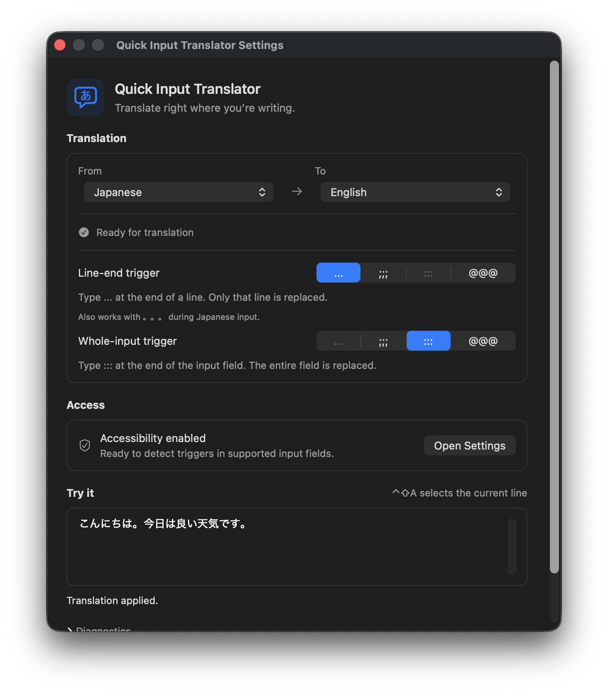

# Quick Input Translator

Translate what you’re writing, right in the input field. This macOS menu bar app uses Apple’s on-device Translation framework and replaces your text with the translation. It never sends or posts the result.

With the default settings, type `...` to translate the current line, or `:::` to translate the entire input field. You can choose the source language, target language, and both triggers.



## Install

Requires an **Apple Silicon Mac with macOS 26 or later**. Release downloads do not require Xcode, a developer certificate, or a translation API key.

Quit any running copy of Quick Input Translator, then paste these commands into Terminal:

```sh
curl -fL https://github.com/azu/quick-input-translator/releases/latest/download/quick-input-translator-macos-arm64.zip -o "$TMPDIR/quick-input-translator.zip" &&
ditto -x -k "$TMPDIR/quick-input-translator.zip" /Applications &&
xattr -dr com.apple.quarantine "/Applications/Quick Input Translator.app" &&
open "/Applications/Quick Input Translator.app"
```

The commands install and open `/Applications/Quick Input Translator.app`. The app is self-signed and isn’t notarized; the `xattr` command removes its quarantine attribute so macOS can open it. You do not need to import its signing certificate.

**Upgrading from v1.0.x?** Use the same commands once to install v1.1.1 or later. Then remove the old entry and add `/Applications/Quick Input Translator.app` again in **System Settings → Privacy & Security → Accessibility**. The signing identity changes in this release, so this one-time permission reset is necessary. Future releases use the fixed identity; permission retention across a full update still needs real-device verification.

## First-time setup

Settings open when the app starts. To reopen them, click the menu bar icon and choose **Settings…**, or press **Command+,** while the app is active.

1. Set **From** and **To** to different languages. For a first test, choose Japanese → English.
2. Click **Prepare Languages** if the app needs a language model. Complete Apple’s download dialog and wait until the app says it is ready.
3. Try translating in the **Try it** field in Settings using the examples below. This field works without Accessibility permission.
4. To translate in other apps, click **Allow Access** and enable Quick Input Translator in **System Settings → Privacy & Security → Accessibility**. Return to the app; permission changes are detected automatically.

Your language choices are saved. The source language initially defaults to Japanese; **To → System language** follows your supported OS language preferences, falling back to English when needed. The interface stays in English regardless of the translation language.

## Translate while writing

Click inside a supported editable text field and type your text normally. You do not need to select the text or press a translation shortcut.

| What to translate | Default trigger | Where to type it | What gets replaced |
| --- | --- | --- | --- |
| Current line | `...` | At the end of that line | Only that line; surrounding lines stay unchanged |
| Entire input field | `:::` | At the very end of the field | The whole draft, including multiple lines |

### Translate one line

With **From → Japanese** and **To → English**, type this in the test field or a supported input field:

```text
こんにちは。今日は良い天気です。...
```

Typing the final dot starts translation. The app replaces the line with English and removes the trigger. A visually wrapped line still counts as one line until you insert a line break.

### Translate a whole draft

Write your draft across several lines, then type `:::` at the very end:

```text
こんにちは。
明日の打ち合わせは10時からです。:::
```

The app translates the entire field in one request and replaces it in place. A whole-input trigger in an earlier line does not start a translation.

### While translation is running

A small spinner appears near the trigger, followed briefly by a checkmark when replacement succeeds. Wait for completion before typing more or switching fields. Changing the text, selection, focused field, language, or trigger can cancel the replacement.

If translation fails, the app displays a reason. Check the field before retrying: a failure to confirm a paste does not always mean nothing was pasted. The app does not retry or roll back an unconfirmed paste.

The translated text is still your draft. Review it and send or save it yourself.

### Undo and shortcuts

Use the input app’s **Command+Z** immediately after replacement to undo the edit. Restoring the original text, including the trigger, as one edit is tested in the built-in field; Undo in other apps depends on their text editor and needs verification.

**Control+Shift+A** only selects the current logical line. It does not translate, and you do not need to use it before typing a trigger. An existing selection is preserved.

### Change the triggers

In Settings, choose **Line-end trigger** and **Whole-input trigger** from `...`, `;;;`, `:::`, and `@@@`. The two choices must be different and are saved between launches. Existing users keep their saved line trigger; the whole-input trigger may start as `@@@` if `:::` was already in use.

For a trigger set to `...`, Japanese IME input `。。。` and automatic substitution to `…` also work. In the built-in field you can type the trigger before confirming Japanese composition; support in other apps depends on what their input fields expose.

Type the trigger directly. Pasting a trigger, typing it in the middle of a line, or typing one, two, or four or more repeated characters does not start translation.

## Updates

Starting with v1.1.1, release builds use [Sparkle](https://sparkle-project.org/documentation/customization/) to check for updates daily, download verified updates in the background, and normally install them when you quit. No install command is needed for later in-app updates.

Open the menu bar menu to choose:

| Menu item | What it does |
| --- | --- |
| **Check for Updates…** | Check now and choose whether to install and relaunch |
| **Automatically Check for Updates** | Turn scheduled checks on or off |
| **Automatically Install Updates** | Turn automatic download and installation on or off; available while automatic checking is enabled |

Your choices are saved. If installation requires authorization, the update window explains the next step. Development builds do not install release updates.

## Troubleshooting

| Problem | What to check |
| --- | --- |
| The test field works, but other apps do not | Enable Accessibility for the copy in `/Applications`. After upgrading from v1.0.x, remove and re-add that entry once. |
| Nothing happens after typing a trigger | Check the trigger selected in Settings and type it at the end of the line or field. A pasted trigger does not count. |
| The language is not ready | Choose different supported languages, then click **Prepare Languages** and complete the model download. |
| Triggers are not detected outside Settings | Expand **Diagnostics** and check trigger monitoring and Secure Input. Secure Input can block monitoring in other apps. |
| The app reports a replacement failure | Inspect the input field and clipboard before retrying. Keep the same field focused until the operation finishes. |

### Supported input fields

The app needs an editable field that exposes its text and selection through macOS Accessibility. Password fields, read-only content, and editors that do not expose this information are unsupported. Terminal input support is incomplete: visible screen text does not reliably identify the editable command buffer.

Line translation and replacement have been verified in the built-in field and a standard multiline input in Arc. Whole-input translation and Undo are covered by native-editor tests, but whole-input replacement and Undo in external apps still need end-to-end verification. Chrome, Slack, and VS Code have not been verified. The paragraph-coordinate correction for richer browser editors has automated tests; its end-to-end verification is still pending.

### Clipboard and privacy

Translation uses Apple’s on-device Translation framework. Language models are prepared separately; the app does not start a model download while you are typing in another app.

Replacement in other apps temporarily places the translation on the clipboard. After a confirmed paste, the previous clipboard formats are restored unless you copied something else in the meantime. If the paste cannot be confirmed, the translation stays on the clipboard unless another copy replaced it. Clipboard managers may observe this temporary content. The built-in test field does not use the clipboard.

Logs record operation IDs, processing stages, app identifiers, numeric ranges, OS return codes, and replacement status. They do not record source text, translations, clipboard contents, or keystroke history. To inspect events from the last 15 minutes, or follow them while reproducing a problem:

```sh
bash scripts/logs.sh
bash scripts/logs.sh --stream
```

Release updates use a fixed self-signed certificate, plus Ed25519 signatures for the archive and update feed. Local builds use your Apple Development certificate and refuse to silently fall back to ad-hoc signing. Developer ID signing and notarization are not set up.

## Build from source

Local builds require macOS 26 or later, a compatible Xcode installation, and an Apple Development signing certificate in your keychain. Swift Package Manager downloads the pinned Sparkle framework. No translation API keys are needed.

```sh
bash scripts/build-app.sh
open "dist/Quick Input Translator.app"
```

The build automatically uses your Apple Development certificate when exactly one is available. Otherwise, set `CODE_SIGN_IDENTITY` to the certificate’s ID. Builds keep the same signing identity, bundle identifier, and app location so Accessibility permission can survive updates. Switching from an older ad-hoc build requires granting permission once again.

The first build after the rename migrates `dist/Quick Translate Input.app` to `dist/Quick Input Translator.app` after checking the signing requirement. Your saved settings use the same bundle identifier; check Accessibility access after this one-time location change.

Quit Quick Input Translator before rebuilding. The build stops if the app is still running, so it doesn’t replace the bundle underneath a process using Accessibility access. Open the new build after the update completes.

## Development

```sh
swift test
swift build
bash scripts/test-version.sh
bash scripts/test-release-notes.sh
./bin/sdev lint
```

Tests cover both trigger scopes, whole-field ranges and Japanese composition, independent trigger settings and migration, native-editor Undo, language selection and persistence, replacement guards, clipboard restoration, and cancellation. Model downloads, Accessibility permission, and compatibility with external input fields also need GUI verification.

To test real Japanese-to-English translation on a physical Mac with both language models installed:

```sh
RUN_TRANSLATION_INTEGRATION=1 swift test --filter installedJapaneseEnglishModelTranslates
```

These opt-in tests check single-string translation and whole-field translation followed by native-editor replacement. They don’t download models and are skipped in normal test runs.

Start with the [project documentation](docs/README.md) for the product, requirements, and design. The design notes are currently in Japanese.

## Releases

`VERSION` is the source for the app version and release tag. Versions use `MAJOR.MINOR.PATCH`; tags use `vMAJOR.MINOR.PATCH`.

Run **Create Release PR** in GitHub Actions on `main` and choose `patch`, `minor`, or `major` (default: `patch`). The workflow calculates the next version from `VERSION`, changes only that file, and opens a `release/v…` PR. Review and merge that PR to create the tag, run tests on macOS 26, and publish the Apple Silicon ZIP, SHA-256 checksum, and signed `appcast.xml`. Enable **Settings → Actions → General → Allow GitHub Actions to create and approve pull requests** if PR creation is disabled.

The increments follow [Semantic Versioning](https://semver.org/): `patch` for compatible fixes, `minor` for compatible additions, and `major` for incompatible changes. Starting from `1.2.3`, they produce `1.2.4`, `1.3.0`, and `2.0.0` respectively. The same choices work locally with `bash scripts/version.sh --bump patch`. Releases use the normal three-part version format; prerelease labels and build metadata aren’t supported.

The release PR body starts with GitHub’s automatically generated release notes. Review and edit that body before merging: the published release uses the complete PR body unchanged. This follows the [release-note workflow described on efcl.info](https://efcl.info/2023/03/11/auto-release-note/). Tag-triggered releases and manual retries also reuse the body of the matching merged release PR. Only releases without a matching PR generate new notes; an empty PR body or a failed API request stops publication.

You can also release the current version by pushing its matching tag, including the first release:

```sh
git tag "v$(cat VERSION)"
git push origin "v$(cat VERSION)"
```

The **Release** workflow also accepts an existing tag through manual dispatch for retries. It refuses a tag that differs from `VERSION`. Assets are attached to a draft before publication; a retry can replace assets in a draft, but doesn’t overwrite an already published release. Both workflows use `GITHUB_TOKEN`; no personal access token is required. The Release workflow also requires the signing secrets described below. If a bot merges the release PR using `GITHUB_TOKEN`, create and push the matching tag yourself, because that merge event won’t start another workflow.

Initial key generation requires OpenSSL 3 and the Swift toolchain. Before the first signed release, the maintainer runs `bash scripts/setup-update-signing.sh` once. This creates the public `config/update-signing.json` and private `.update-signing/` directory. Commit only the public config, and back up the private directory securely outside the checkout. Never regenerate these keys for a new release: losing or replacing them breaks update continuity. The setup refuses to replace existing material.

Set these repository Actions secrets using the generated files:

| Secret | Value |
| --- | --- |
| `CODE_SIGN_P12_BASE64` | Base64 encoding of `.update-signing/code-signing.p12` |
| `CODE_SIGN_P12_PASSWORD` | Contents of `.update-signing/p12-password` |
| `SPARKLE_PRIVATE_KEY` | Contents of `.update-signing/sparkle-private-key` |

The build checks the certificate against the committed SHA-256 fingerprint and verifies the archive signature against the committed Sparkle public key. Missing or different keys stop the release. GitHub-hosted runners trust the certificate only for code signing. Cleanup attempts to remove that trust and the temporary keychain with a time limit for each operation; the disposable runner is destroyed after the job. For local packaging, run `bash scripts/trust-release-certificate.sh` once; macOS may ask you to authenticate. This adds only code-signing trust on the authoring Mac. Users installing the app do not need to import the certificate.

To package a release locally without modifying the certificate-signed app in `dist`:

```sh
bash scripts/package-release.sh
```
