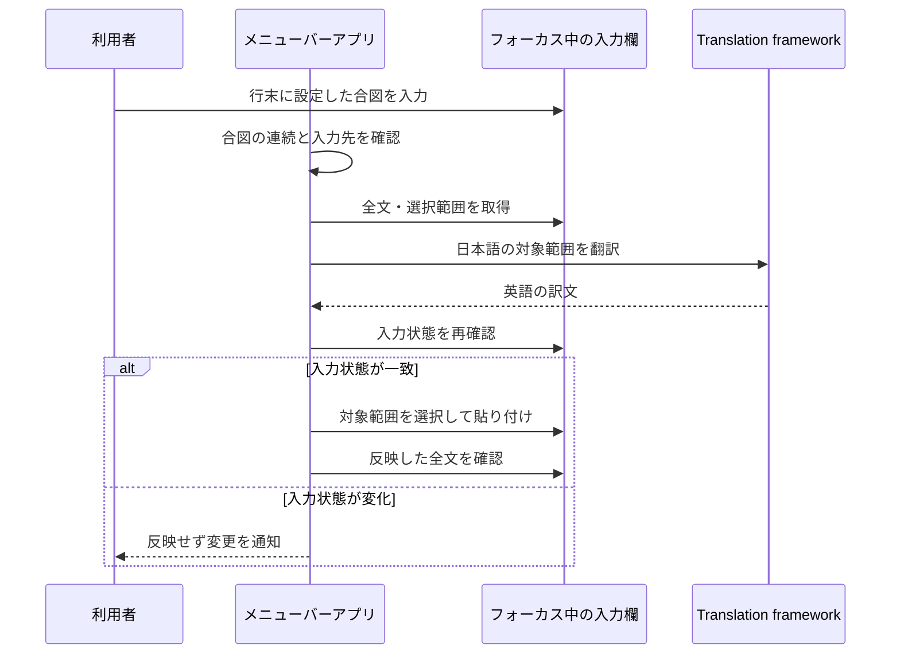

# 入力内容の翻訳の設計

## このドキュメントについて

[Requirements](requirements.md)と[Product](../../product.md)に基づき、Macの入力欄の取得・翻訳・置換を実現する。

### 対象読者

この機能を実装・変更する人とエージェント。

### 前提知識

macOSのアクセシビリティAPIは、別アプリの入力欄と選択範囲を取得できる。
利用する属性は入力欄によって異なるため、取得の成功と選択範囲の変更可否を確認する。
[AppleのAXUIElement資料](https://developer.apple.com/documentation/applicationservices/axuielement_h)を参照する。

### このドキュメントで扱わないこと

アプリごとの回避処理、配布用の公証、翻訳品質の比較は扱わない。

## 実装方針

Swift PackageでmacOS 26以降のメニューバーアプリを作る。
AppKitでメニューと準備画面を管理し、SwiftUIのtranslationTaskで言語モデルを準備する。
他の入力欄の翻訳にはTranslationSession(installedSource:target:)を使い、準備画面へフォーカスを移さずに翻訳する。
この初期化方法はインストール済みのモデルが必要なため、未準備なら準備画面を案内する。
[Appleの初期化API](https://developer.apple.com/documentation/translation/translationsession/init(installedsource:target:))と[公式サンプル](https://developer.apple.com/documentation/translation/translating-text-within-your-app)に基づく。

CarbonのRegisterEventHotKeyでCtrl＋Shift＋Aを登録する。
修飾キーが離された後に現在の行を選択する。翻訳は呼び出さず、既存の選択がある場合は維持する。
登録の失敗は準備画面で知らせる。

翻訳の合図はNSEventのローカル・グローバルのイベント監視で検出する。
両方の監視が必要なことと、グローバルのキー監視にアクセシビリティ権限が必要なことは、[Appleのイベント監視ガイド](https://developer.apple.com/library/archive/documentation/Cocoa/Conceptual/EventOverview/MonitoringEvents/MonitoringEvents.html)に基づく。
自アプリのイベント監視は起動時に開始する。他アプリのイベント監視は権限を確認してから開始し、権限状態の再確認時に開始・停止する。
監視では選んだ合図の記号の連続回数だけを持ち、キーの履歴は保持しない。
三回目の記号でフォーカス中の入力欄の識別子を保存し、入力がアプリへ反映されるまで最大600ミリ秒待つ。
待機中に別のキーやクリックがあった場合は候補を取り消す。
同じ入力欄にカーソルがあり、行末が合図になっていることを確認してから翻訳する。
貼り付けによる文字列設定はキー入力の連続と見なさない。
`...`の設定では、キーイベントの`。`も同じ合図の文字として受け付ける。

自分のアプリ内の入力欄は、ローカルイベントのwindowからNSTextViewを識別する。
自分のメインスレッドへAXの処理を送り返す方法に依存せず、NSTextViewから全文と選択範囲を取得する。
未確定の行末に合図がある場合は、NSTextInputClientのunmarkTextで入力を受け付け、Returnキーを送らずに確定する。
[AppleのunmarkText資料](https://developer.apple.com/documentation/appkit/nstextinputclient/unmarktext())に基づく。
自分の入力欄の反映は、shouldChangeText・textStorageの変更・didChangeTextを通して行い、SwiftUIへの変更通知を送る。
他アプリではAXで公開された入力情報を取得し、公開されていない未確定文字を推測で補わない。

入力の取得にはAXFocusedUIElement、AXValue、AXSelectedTextRangeを使う。
パスワードのsubroleを先に確認して除外し、編集可能と確認できること、および選択範囲を変更できることを確認する。
編集可能かどうかはAXIsEditable、またはAXValueの書き込み可否で判断する。AXValueへの書き込み自体は行わない。
全文の範囲はNSStringとNSRangeのUTF-16単位で扱い、行末の改行を除く論理行を求める。
翻訳用のTextTargetでは置換範囲に合図を含め、翻訳元の文字列からだけ合図を取り除く。
原文と訳文が同じでも、合図を除去するために置換する。

翻訳後にフォーカス・全文・選択範囲を再確認し、対象範囲を選択してCommand＋Vを送る。
AXSelectedTextはSDKの定義上読み取り属性なので、直接の書き換えに依存しない。
入力欄の全文を一括設定する方式は、前後の文章やアプリの編集処理を壊すおそれがあるため採用しない。

貼り付け後、最大1秒間、全文が期待した結果と一致するか確認する。
成功なら、クリップボードの変更回数が自分の書き込み時から変わっていない場合だけ、保存した全形式のデータを復元する。
元の形式をすべて読み取れない場合や、保存中にクリップボードが変わった場合は、書き込む前に中止する。
失敗ならクリップボードを維持し、自動再試行しない。フォーカスが失われた場合も成功とみなさない。
貼り付け前にエラーがあった場合は、同じ入力状態であることを確認できる範囲で選択位置とクリップボードを戻す。

## アーキテクチャ・シーケンス図

## データモデル・ER 図

TextTargetは全文、元の選択範囲、置換範囲、対象文字列を持つ値とする。
TranslationTriggerは三つの候補を持つ列挙型とする。保存値が未設定または不明なら`...`を使う。
CapturedInputは入力先の識別子とTextTargetを一回の処理中だけ保持する。
入力先は、自アプリのNSTextViewまたは他アプリのAXUIElementとプロセスIDで表す。
クリップボードは各NSPasteboardItemの全typeとDataを一時保持する。
永続化するデータ間の関係がないためER図は不要。

## API・インターフェース

利用者の入口は行末への合図入力、行選択のショートカット、メニューバーの「準備とテスト」。
準備画面から権限設定を開き、日本語・英語のモデルを準備し、テスト用入力欄で試せる。
内部の翻訳処理と入力処理はプロトコルで分ける。
状態は準備完了、翻訳中、完了、理由付きの失敗とし、本文を状態文字列に含めない。
進行と結果は、入力欄の近くの非アクティブなNSPanelにも表示する。
NSPanelはキーウィンドウにならず、クリックを受けず、入力欄のフォーカスを維持する。
自アプリの入力位置はfirstRect、他アプリの位置はAXBoundsForRangeで求める。位置を取得できなければポインター付近に表示する。
処理中は回転表示を出し、完了・失敗は5秒後に閉じる。

## 外部サービスとの連携方式

外部APIへの接続・認証は追加しない。
Translation frameworkのja→enを使い、未インストールや翻訳失敗はエラーとして利用者へ返す。

## データの取り扱い設計

入力欄の本文は翻訳の合図を確認するとき、行選択時、反映確認時に取得し、処理中だけメモリに保持する。
監視では選んだ合図の記号の連続回数だけを保存し、他の文字は保存しない。
全文・訳文・クリップボードの内容をログへ出さない。
合図の設定だけをUserDefaultsのtranslationTriggerキーに保存する。本文のファイル保存は行わない。
設定を変更すると待機中の候補と連続回数を取り消し、変更後の合図だけを使う。

## 認証認可に関する特記事項

AXIsProcessTrustedWithOptionsでアクセシビリティ権限を案内する。
権限要求は準備画面の操作で行い、権限がなければ他アプリの入力の取得を開始しない。
自アプリ内では入力元のNSTextViewを直接扱い、AXの権限を要求しない。
アプリはApp Sandboxを使わず、ローカル実行用のapp bundleとして生成する。

## セキュリティ上の留意事項

AXSecureTextFieldを本文の取得前に除外する。
貼り付け前の確認と実際の入力先の編集は、OSが提供する一つの不可分な処理にはできない。
貼り付けを送った後の不一致では、利用者の変更を上書きする巻き戻しを行わない。
任意の他アプリがクリップボードを読むことは防げないため、その制約を利用方法に記載する。

## デプロイに関する特記事項

なし。通常のローカルビルドでapp bundleを生成する。
Developer ID署名と公証による配布は対象外。

## 検討した代替手段

### 入力欄の全文をAXValueで書き換える

クリップボードを使わずに済むが、対象以外の編集やアプリの取り消し処理への影響が大きいため採用しない。

### コピーのキー操作で原文を取得する

AXValueが取れないアプリを増やせる可能性はあるが、選択状態やコピー内容を誤認する危険がある。
初期実装では入力状態を確認できる入力欄を扱い、取得できなければ中止する。

## 未決事項

アプリごとのアクセシビリティ対応は実機で確認する。
必要な属性を提供しないアプリへの対応方法は、対象が分かったときに要件とともに見直す。
