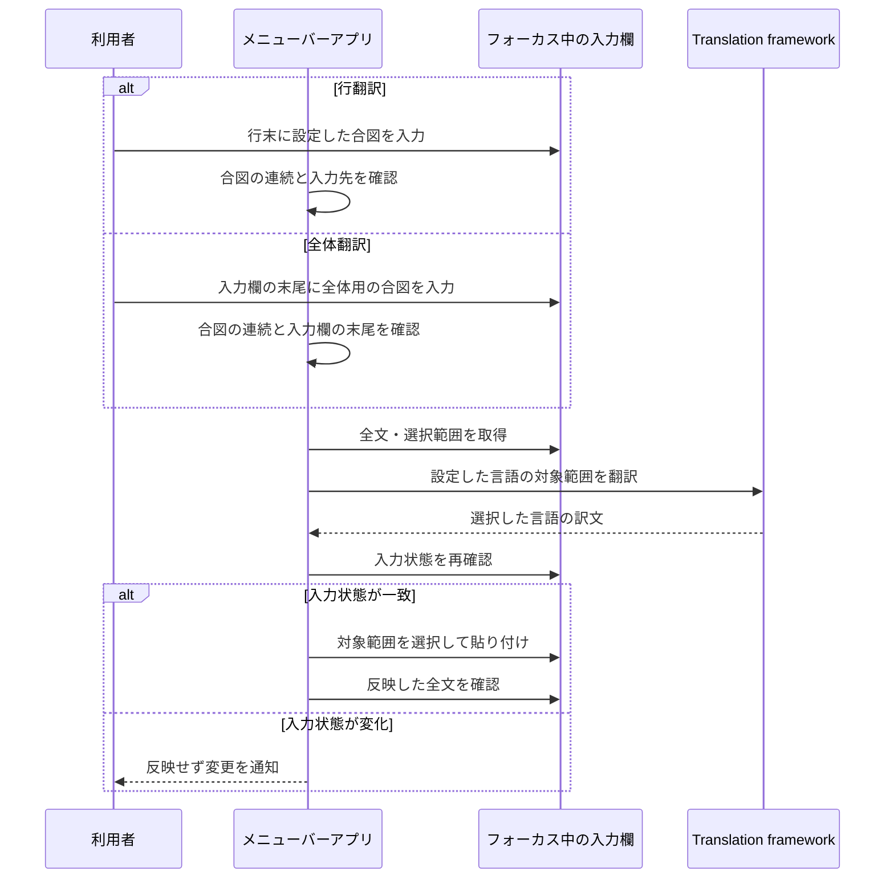

# 入力内容の翻訳の設計

## このドキュメントについて

[Requirements](requirements.md)と[Product](../../product.md)に基づき、Macの入力欄の取得・翻訳・置換を実現する。

### 対象読者

この機能を実装・変更する人とエージェント。

### 前提知識

macOSのアクセシビリティAPIは、別アプリの入力欄と選択範囲を取得できる。
利用する属性は入力欄によって異なるため、取得の成功と選択範囲の変更可否を確認する。
[AppleのAXUIElement資料](https://developer.apple.com/documentation/applicationservices/axuielement_h)を参照する。

### このドキュメントで扱わないこと

アプリごとの回避処理、配布用の公証、翻訳品質の比較は扱わない。

## 実装方針

この節では、採用する方法とその理由を示す。
実行時の判定条件と処理順序は「処理の流れ」に記述する。

### 実行環境と翻訳エンジン

Swift PackageでmacOS 26以降のメニューバーアプリを作る。
AppKitでメニューと準備画面を管理し、AppleのTranslation frameworkで翻訳する。
生成するアプリはApp Sandboxを使わず、ローカル実行用のapp bundleとする。

言語モデルの準備と日常の翻訳は、別の接点を使う。

- モデルの準備には、確認画面を表示できるSwiftUIのtranslationTaskを使う。
- 日常の翻訳には、インストール済みのモデルを使うTranslationSession(installedSource:target:)を使う。入力欄のフォーカスを保つため、この経路から準備画面を開かない。

[Appleの初期化API](https://developer.apple.com/documentation/translation/translationsession/init(installedsource:target:))と[公式サンプル](https://developer.apple.com/documentation/translation/translating-text-within-your-app)に基づく。

### 翻訳と行選択の起動方法

行翻訳と全体翻訳は、どちらも文字の合図で起動する。
入力中に合図を付ける操作を共通にするため、全体翻訳用のホットキーは追加しない。

行選択には、CarbonのRegisterEventHotKeyで登録したCtrl＋Shift＋Aを使う。
この操作は入力欄の範囲を選択する補助操作とし、翻訳の起動とは分ける。
登録に失敗した場合は準備画面で知らせる。

### 入力欄の取得と訳文の反映方法

入力欄の取得方法は、対象アプリに合わせて選ぶ。

- 自アプリではNSTextViewを直接扱う。自分のメインスレッドへAXの処理を送り返す方法への依存を避けるため。
- 他アプリではアクセシビリティAPIを使う。公開された本文・選択範囲・フォーカスを照合して、対象を確認するため。

他アプリへの訳文の反映には、対象範囲を選択して貼り付ける方式を採用する。
反映方式の判断は次のとおり。

- 選択と貼り付け：AXで対象範囲を指定し、対象アプリの通常の編集処理へ渡す方式として採用する。
- AXSelectedTextへの直接書き込み：Arcの実機ログで、書き込み可能と判定され、設定APIも成功を返したのに本文が元のままになることを確認したため、採用しない。
- AXValueへの全文の直接設定：対象範囲やアプリの編集処理を壊すおそれがあるため、採用しない。

### 全文の翻訳単位と取り消し

入力欄全体の翻訳では、全文を一つの文字列として翻訳エンジンに渡す。

訳文は一回の置換で反映し、入力先アプリの通常の編集履歴で取り消せるようにする。
自アプリでも、翻訳前の入力とは別の一つの取り消し単位として扱う。
独自の原文履歴の保存と、他アプリの取り消し操作の横取りは追加しない。
[Appleの取り消し操作の指針](https://developer.apple.com/design/human-interface-guidelines/undo-and-redo)に従い、入力先アプリのCommand＋Zを使う。

### 設定画面

設定画面は、日常の設定を先に選べる配置にする。
上から言語・合図、アクセス権限、テスト欄の順に並べ、キー受信・監視登録・セキュア入力の詳細はDisclosureGroup内へ置く。
共通の余白、標準Picker・Button、システムの配色を使い、状態は文字でも示す。

合図には「Line-end trigger」と「Whole-input trigger」の選択欄を並べ、どちらも`@@@`・`:::`・`;;;`・`...`から選択する。
この二つの選択欄は、NSSegmentedControlをNSViewRepresentableで表示する。
SwiftUIのsegmented Pickerでは個々の候補の無効化が実画面へ反映されなかったため、AppKitのsetEnabled(_:forSegment:)で他方が使用中の候補を無効にする。
各欄には、選択した合図と翻訳範囲の説明を添える。
UIとエラーは英語、READMEも英語とし、Command＋CommaでSettingsを開く。
[Appleの設定画面指針](https://developer.apple.com/design/human-interface-guidelines/settings)と[配置指針](https://developer.apple.com/design/human-interface-guidelines/layout)に基づく。

## 処理の流れ

この節では、起動後に行う処理と、次へ進む条件・中止する条件を示す。

### 入力監視の開始と状態の確認

自アプリと他アプリの両方で翻訳の合図を検出するため、NSEventのローカル監視とグローバル監視を併用する。
ローカル監視は自アプリに届く入力を、グローバル監視は他アプリに届く入力を受け持つ。
（出典：[Appleのイベント監視ガイド](https://developer.apple.com/library/archive/documentation/Cocoa/Conceptual/EventOverview/MonitoringEvents/MonitoringEvents.html)）

監視の開始時期は、権限の要否に合わせて分ける。
自アプリのローカル監視は起動時に開始する。
他アプリのキーを受け取るグローバル監視にはアクセシビリティ権限が必要なため、権限を確認してから開始する。
起動後の許可や取り消しにも追従できるよう、権限は起動時と1秒ごとに確認し、結果に応じてグローバル監視を開始・停止する。

監視を登録できたことと、実際にキー入力を受け取れたことは、準備画面で区別できるようにする。
そのため、他アプリのキーを最後に受信した時刻を表示し、表示の更新頻度を最大1秒に1回とする。
本文の記録を避けるため、キーの文字列と入力履歴は保持しない。

セキュア入力によって合図を検出できない場合は、準備画面にその理由を表示する。
この状態を判定するため、権限確認と同じ1秒周期でIsSecureEventInputEnabledを読む。
OSや他アプリの保護設定は変更しない。

### 合図候補の検出

入力監視は、行用と全体用の合図ごとに記号の連続回数を追跡する。
三回目の記号で入力欄の識別子を保存し、翻訳範囲と合図を組で保持する。

キーイベントの受信時点では、入力先の本文に合図が反映されていない場合がある。
その反映を確認できるまで最大600ミリ秒待ち、待機中に別のキーやクリックがあった場合は候補を取り消す。

合図の判定対象は、利用者が続けて入力したキーイベントとする。
この条件に従い、貼り付けによる文字列設定は判定対象から外す。
日本語IMEからも`...`の合図を使えるよう、この設定ではキーイベントの`。`も同じ合図の文字として受け付ける。

### 入力欄の取得と日本語入力の確定

自アプリでは、ローカルイベントのwindowからNSTextViewを識別し、全文と選択範囲を取得する。

取得対象の末尾に未確定の合図がある場合は、NSTextInputClientのunmarkTextで入力を受け付けて確定する。
このAPIで確定することで、入力先にReturnキーを送る処理を避ける。
行翻訳・全体翻訳とも同じ方法を使う。
[AppleのunmarkText資料](https://developer.apple.com/documentation/appkit/nstextinputclient/unmarktext())に基づく。

他アプリでは、最前面アプリのAXApplicationからAXFocusedUIElementを取得する。
入力要素と最前面アプリのプロセスIDを組で保持し、反映前にも同じアプリが最前面で、同じ要素をフォーカスしていることを確認する。
複数プロセスのブラウザでは要素の所有プロセスと最前面アプリのプロセスが異なる場合があるため、入力要素自身のプロセスIDとの一致は要求しない。

本文の取得前にパスワードのsubroleを除外し、編集可能かどうかと選択範囲の変更可否を確認する。
編集可能かどうかはAXIsEditable、またはAXValueの書き込み可否で判断する。
本文はAXValue、選択範囲はAXSelectedTextRangeから取得し、公開されていない未確定文字は推測で補わない。

入力欄の取得に失敗した場合は、処理を中止して進行表示に理由を残す。
これにより、入力を取得できていない状態を翻訳中と区別できるようにする。
AXFocusedUIElementの読み取りがapiDisabledを返した場合は、権限不足として表示する。
事前の権限確認が許可済みでも、読み取りAPIの拒否を「入力欄が見つからない」に読み替えない。

### 文字位置の照合と翻訳対象の決定

表示上の文字位置と選択APIの位置を照合して、TextTargetを作る。
両者の位置を比較できるよう、文字位置はNSStringとNSRangeのUTF-16単位で扱う。
Chromiumの編集領域では、AXValueに段落の改行が追加されても、AXSelectedTextRangeの位置にはその改行が含まれない場合がある。
この場合はAXStringForRangeが返す文字列とAXValueを照合し、表示上にだけ追加されたLFに限って位置の対応を作る。
他の文字に差があれば中止する。

範囲読み取りの上限がAXValueより短い場合は、読み取り専用の二分探索で上限を求める。
位置の対応付けに使うAPIに対応しない入力欄では、従来の座標を使う。

得られた位置の候補から、TextTargetの合図判定を通るものを一意に選ぶ。
通常の行選択で位置が一意に決まらない場合は中止する。

翻訳範囲は、検出した合図に対応するCaptureModeで決める。

- triggeredLine(TranslationTrigger)：行末の改行を除く論理行を置換範囲にする。同じ入力欄にカーソルがあり、選択末尾が合図のある行末に一致することを確認する。
- triggeredField(TranslationTrigger)：合図を含む全文を置換範囲にする。全文末尾が選んだ合図で、選択末尾も全文末尾に一致することを確認する。途中の行末に全体用の合図がある場合は発動対象から外す。

TextTargetは、合図を含む置換範囲、末尾の合図だけを除いたsourceText、合図のtriggerRange、変更検知用の元の選択範囲を保持する。
原文が空白だけの場合、記号が四つ以上連続する場合、合図の後に文字がある場合は翻訳対象から外す。
全体用の合図が条件を満たさない場合に、行翻訳へ切り替える処理は行わない。

### 進行表示の位置決め

進行表示は、利用者が入力した合図の近くに置く。
どの入力に対する処理かを示すため、完了や失敗に切り替わった後も同じ合図を位置の基準にする。
行翻訳では行末、全体翻訳では入力欄末尾の合図を使う。

表示の基準となる位置は、次の順に取得する。

1. TextTargetのtriggerRangeから合図の範囲を取り出し、自アプリではfirstRect、他アプリではAXBoundsForRangeで画面上の位置を求める。
2. 合図の位置を取得できなければ、入力カーソルの位置を使う。幅が0でも高さがあれば、有効な位置として扱う。
3. 入力カーソルの位置も取得できなければ、マウスポインター付近に表示する。

合図の位置が得られた場合は、合図の上辺から6ポイント上に表示し、横方向の中心をそろえる。
上側に収まらない場合は下側へ移し、複数画面を含めて表示先の画面内に収める。

### 翻訳の実行と中止

翻訳開始時に言語の組み合わせを固定し、同一言語・未対応・未準備を区別する。
TranslationSession(installedSource:target:)にはインストール済みのモデルが必要なため、未準備なら準備画面を案内する。

行翻訳と全体翻訳は同じ実行中状態を共有し、一つの処理を実行する。
この処理で取得した入力状態を保てる間だけ、訳文を反映する。
翻訳中にキー入力やクリックがあった場合は処理をキャンセルする。
表示上の別の位置が選択APIで同じ位置になる場合も、利用者の操作があれば中止する。
言語または合図の設定が変わった場合も、待機中の候補と実行中の翻訳をキャンセルする。

### 訳文の反映

翻訳後にフォーカス・全文・選択範囲を再確認し、対象範囲を選択する。
他アプリでは表示上の位置から選択APIの位置へ逆変換し、AXSelectedTextが置換元と一致することも確認する。
Chromiumの段落を含む選択では、AXSelectedTextにも表示用の改行が含まれない場合がある。
[Chromiumの実装](https://chromium.googlesource.com/chromium/src/+/91b8a39168581465b04ca89ef0ba2a9e17e7c35e/ui/accessibility/platform/browser_accessibility_cocoa.mm)でも、全文のAXValueと選択文字列のAXSelectedTextは別の方法で取得している。
その場合は、取得時にAXStringForRangeと照合して作った位置の対応を使い、選択API側の文字列とも比較する。
表示上にだけ追加されたと確認済みのLFだけを差として認め、実際の改行や他の文字に違いがあれば中止する。
この確認は行翻訳と全体翻訳の両方に適用する。
全体翻訳でも全文の範囲を安全に選択できることを確認し、確認できなければ中止する。

選択範囲の変更が他アプリからの読み取りへ反映されるまで、最大500ミリ秒待つ。
待機中は全文とフォーカスを毎回検証し、選択範囲が元の範囲と要求した範囲以外に変わったら中止する。
要求した範囲を確認できたら、訳文の貼り付けへ進む。

他アプリへの貼り付け前に、クリップボードの全形式のデータを保存する。
元の形式をすべて読み取れない場合や保存中にクリップボードが変わった場合は、書き込む前に中止する。

クリップボードへ訳文を設定した後、[Appleのプロセスを指定したイベント送信API](https://developer.apple.com/documentation/coregraphics/cgevent/posttopid(_:))で、対象アプリのプロセスだけへCommand＋Vを送る。
全体のHID入力経路へは送らない。
キーを押してから離すまで20ミリ秒空け、キャンセル時も離すイベントは必ず同じプロセスへ送る。

貼り付けの要求は一度だけ送る。
遅れて届く要求で二重に挿入されることを防ぐため、要求後は別方式への切り替えと再送を行わない。
原文と訳文が同じ場合も、合図を除去するために一度の置換を行う。

自アプリの反映では取り消しを有効にし、変更通知の直前に入力の取り消し単位を区切る。
shouldChangeText・textStorageの変更・didChangeTextを通し、SwiftUIへの変更通知を送る。

### 反映確認と復元

置換を要求した後は、最大2秒間、全文が期待した結果と一致するか確認する。
元の文字列のままなら待機し、異なる内容への変更やフォーカス移動があれば確認を中止する。
フォーカスが失われた場合は、成功とみなさない。

全文が一致しない場合は、貼り付け後のAXValueとAXStringForRangeを読み直して段落の表現差を確認する。
表示上にだけあると確認できた段落区切りに限り、LF一つと二つの差を認める。
翻訳前に表示用の段落区切りがあると確認できた同じ入力欄では、その情報も引き継ぐ。
貼り付け後にAXStringForRangeの改行表現が変わっても、同じ欄を通常のテキスト欄と誤認しないため。
[Blueskyの入力欄](https://github.com/bluesky-social/social-app/blob/main/src/view/com/composer/text-input/TextInput.web.tsx)は、貼り付けた各行を空行も含めて段落に変換する。
このとき、空の段落を含む訳文とAXValueが返す文字列とで改行数が変わる場合に対応する。
段落区切りの位置と本文・空白・記号は一致することを要求し、改行を一律に除去して比較しない。
段落の表現差を確認できていない通常の入力欄では、改行数も一致させる。
追加の読み取り後もフォーカスと本文、キャンセル状態を確認してから成功にする。

クリップボードと選択位置の復元は、処理がどこまで進んだかで分ける。

- 反映に成功した場合：クリップボードの変更回数が自分の書き込み時から変わっていなければ、保存した全形式のデータを復元する。
- 貼り付け前にエラーがあった場合：同じ入力状態であることを確認できる範囲で、選択位置とクリップボードを戻す。
- 貼り付け後に反映確認が失敗した場合：一時利用したクリップボードを維持し、自動再試行と本文の巻き戻しは行わない。

### 設定の読み込みと変更

言語の選択肢はLanguageAvailability.supportedLanguagesから読み、Locale.LanguageのminimalIdentifierで保持する。
OS言語は言語コードと文字体系を照合し、簡体字・繁体字を区別する。
言語表示には英語ロケールを使う。

合図のPickerでは、他方で使用中の候補を無効にし、状態更新時にも重複を拒否する。

設定が変わった場合は、以前の設定で始めた待機中の候補と実行中タスクをキャンセルする。
言語状態の非同期取得にも同じ条件を適用し、現在の設定と一致する結果だけを反映する。

## アーキテクチャ・シーケンス図

## データモデル・ER 図

翻訳に使うデータは、一回の処理で取得した入力状態と、その入力に対応する訳文を中心に構成する。
処理の開始後も同じ入力欄と本文を扱っているか確認できるよう、翻訳元だけでなく取得時の全文と選択範囲を保持する。

| データ | 役割と保持する内容 |
| --- | --- |
| TextTarget | 全文、元の選択範囲、置換範囲、翻訳対象のsourceText、合図のtriggerRangeを保持する。文字位置はAXとNSStringが使うUTF-16単位で表す。 |
| CaptureMode | 行選択、合図付き行翻訳のtriggeredLine、合図付き全体翻訳のtriggeredFieldを区別する。 |
| TranslationTrigger | `@@@`・`:::`・`;;;`・`...`の四候補を表す。行用と全体用に一つずつ割り当て、重複しない組み合わせを設定状態とする。 |
| CapturedInput | 入力先の識別子とTextTargetを、一回の処理中だけ保持する。入力先は自アプリのNSTextView、または他アプリのAXUIElementと最前面アプリのプロセスIDで表す。 |
| クリップボードの退避データ | 復元に必要な各NSPasteboardItemの全typeとDataを、一時的に保持する。 |

これらの処理用データはメモリ上で扱う。
永続化するデータ間の関係がないため、ER図は作成しない。

## API・インターフェース

### 利用者の操作

翻訳を起動する操作は、対象の範囲によって二つに分ける。

- 行の翻訳：行末に、設定した行用の合図を入力する。
- 入力欄全体の翻訳：入力欄の末尾に、設定した全体用の合図を入力する。

翻訳を始める前の準備と、入力欄の選択を補助する操作も用意する。

- 行の選択：Ctrl＋Shift＋Aを押す。修飾キーを離した後、未選択なら現在の行を選択し、既存の選択があればその範囲を維持する。この操作から翻訳は起動しない。
- 準備と設定：メニューバーの「Settings…」を開く。準備画面で権限設定を開き、選択した言語のモデルを準備して、テスト用入力欄で翻訳を試せる。

### 内部処理の受け渡し

内部では、入力欄とのやり取りと翻訳エンジンの呼び出しを別の処理として扱う。
両者の受け渡しをプロトコルで定め、TranslationWorkflowが取得・翻訳・反映の順序を管理する。
これにより、入力欄ごとの取得方法と翻訳方法を別々に変更できる。

| 接点 | 入力と出力 |
| --- | --- |
| InputAccess | capture(mode:)でTextTargetを取得し、replace(_:with:)でその範囲を訳文へ置き換える。処理が終わったらclear()で取得時の状態を解放する。 |
| TranslationEngine | translate(_:)で翻訳元の文字列を受け取り、訳文を返す。失敗した場合はエラーを返す。 |

### 進行と結果の表示

翻訳のためにアプリを切り替えなくても処理結果を確認できるよう、入力欄の近くに小さな表示を出す。
この表示には、小さな補助ウィンドウを作るAppKitのNSPanelを使い、入力欄からフォーカスを奪わない設定にする。
パネル上のクリックも元の画面へ通すことで、入力欄での操作を妨げない。

表示内容と閉じるタイミングは、処理の状態に合わせて切り替える。

| 状態 | 表示内容 | 閉じるタイミング |
| --- | --- | --- |
| 入力の確認中・翻訳中 | 28ポイント四方の回転アイコン | 完了または失敗に切り替わるまで表示する。 |
| 完了 | チェック表示 | 1秒後に閉じる。 |
| 失敗 | 失敗理由を読める大きさに広げた表示 | 5秒後に閉じる。 |

アプリ全体では、準備完了・翻訳中・完了・理由付きの失敗を状態として扱う。
状態メッセージは処理の進行と失敗理由を伝える内容とし、入力欄の本文は含めない。
パネルの表示位置は「処理の流れ」の「進行表示の位置決め」で定める。

## 外部サービスとの連携方式

翻訳にはMac上のTranslation frameworkを使う。
選択した言語のモデルが未インストールの場合や翻訳が失敗した場合は、利用者へエラーを返す。
外部の翻訳APIへの接続や認証は追加しない。

## データの取り扱い設計

### 入力本文の一時保持

入力欄の本文は、翻訳と反映の確認に必要な間だけメモリに保持する。
取得するのは、行用または全体用の合図を確認するとき、行選択時、反映確認時とする。
本文をファイルや履歴に保存する処理は設けない。

キー入力の監視では、選んだ二つの合図ごとの記号の連続回数だけを保持する。
合図の検出に使うこの回数と、入力欄から取得した本文は別のデータとして扱い、キー入力の履歴は作らない。

### 診断ログ

失敗した箇所を調べられるよう、OSLogの専用subsystemへ処理の経過を記録する。
合図候補ごとに識別番号を付け、同じ処理の取得・翻訳・選択・反映・確認を追えるようにする。

ログへ含める情報は、次の範囲に限定する。

- 実行環境と処理の経過：起動版、対象アプリの識別子とプロセスID、処理段階、利用した反映方法。
- OSの応答と確認結果：AXの戻り値、PostEventの事前確認、本文の一致・不一致、例外の型と数値コード。
- 位置と長さ：全文の長さ、選択範囲、論理行の範囲、選択末尾と行末の一致、行末・選択末尾・末尾空白の直前での合図の有無。

本文がログへ残らないよう、原文・訳文・そのハッシュ・キー入力・クリップボードの本文・ウィンドウ名・URLは記録対象から外す。
例外のlocalizedDescriptionにも本文が含まれる可能性があるため、記録には型と数値コードを使う。

反映確認のログでは、待機と中止を区別できるようにする。
そのため、元の本文のまま、期待値と一致、別の本文、取得失敗、フォーカス移動、キャンセル、時間切れを分けて記録する。
同じ状態の繰り返しは省略し、保持期間はmacOSの統合ログの管理に従う。

合図の確認が待機期限を超えた場合は、進行表示に失敗理由を出す。
行翻訳では行末、全体翻訳では入力欄末尾の合図とカーソル位置を確認できなかったことを伝える。

### 設定の保存と移行

選択した合図と言語はUserDefaultsに保存し、再起動後も同じ設定を使う。
保存先は次のキーで分ける。

| 設定 | 保存キー | 未設定時の値 |
| --- | --- | --- |
| 行用の合図 | translationTrigger | `...` |
| 全体用の合図 | wholeInputTranslationTrigger | 行用と重複しなければ`:::` |
| 翻訳元 | translationSource | ja |
| 翻訳先 | translationTarget | OSの優先言語に追従するsystem |

既存の利用者の設定を引き継ぐため、行用の合図には既存のtranslationTriggerを使う。
保存値が不明なら行用を`...`へ戻し、その後で全体用の値を確定する。
全体用が未設定・不明・行用と重複する場合は、`:::`、`@@@`、`;;;`、`...`の順に、行用と重複しない最初の候補を割り当てる。

翻訳先が未設定またはsystemの場合は、Locale.preferredLanguagesから対応する言語を選ぶ。
該当する言語がなければenを使う。
この選択でも言語コードと文字体系を照合し、簡体字・繁体字を区別する。

設定変更時は、以前の合図の判定状態を破棄してから新しい設定を使う。
具体的には、待機中の候補、両方の連続回数、実行中の翻訳を取り消す。

## 認証認可に関する特記事項

他アプリの入力欄へアクセスする権限は、利用者が準備画面から許可する。
権限の案内にはAXIsProcessTrustedWithOptionsを使い、許可を確認してから他アプリの入力を取得する。
自アプリのテスト欄はNSTextViewを直接扱うため、この権限なしで利用できる。

## セキュリティ上の留意事項

パスワード欄は本文を取得する前に除外する。
AXSecureTextFieldの判定を先に行うことで、取得後に本文の種類を判断する処理を避ける。

貼り付け直前に入力先を確認しても、その確認と実際の編集を一つの不可分な処理にはできない。
確認後に利用者の操作が入る可能性が残るため、貼り付け後に本文が不一致となっても自動で巻き戻さない。
利用者が加えた変更を上書きしないことを優先する。

貼り付けに使う訳文は、一時的にシステムのクリップボードへ置く。
その間にクリップボードを監視する他のアプリから読まれる可能性があるため、この制約を利用方法に記載する。

## デプロイに関する特記事項

### 生成物と署名元

ローカルビルドでapp bundleを生成し、固定のコード署名証明書で署名する。
更新後も同じアプリとして識別されるよう、アプリ識別子と起動場所も保つ。

署名には、キーチェーン内のApple Development証明書を使う。
候補が一つなら自動で選び、それ以外はCODE_SIGN_IDENTITYで指定する。
署名に使う秘密鍵とキーチェーンの信頼設定は、既存のものを利用する。

### 更新前の検証

ビルドスクリプトは、Quick Translate Inputの起動中にはアプリを更新せず、終了してからの再実行を求める。
起動中のbundle差し替え後に、事前の権限確認と実際のAX読み取りが食い違う状態を避けるため。

更新するアプリは、一時ディレクトリで署名と検証を済ませる。
証明書で署名した旧版がある場合は、その署名要件も満たすことを確認してから置き換える。

署名元が見つからない場合は、理由を表示してビルドを中止する。
仮署名への切り替えや、アプリ識別子だけを条件にした署名要件への緩和は行わない。

### 権限の引き継ぎと配布範囲

仮署名から証明書を使う署名へ切り替えるときは、一度だけ権限を登録し直す。
その後の更新では、既定の署名要件で同じアプリとして識別できる状態を保つ。
この方法は、[Appleの署名要件の説明](https://developer.apple.com/documentation/technotes/tn3127-inside-code-signing-requirements)と[アプリ更新の識別についての説明](https://developer.apple.com/library/archive/technotes/tn2206/_index.html)に基づく。

配布範囲は、このMacでのローカル実行とする。
Developer ID署名と公証による配布は対象外とする。

## 検討した代替手段

### 全体翻訳を専用ショートカットで起動する

- 利点：全文の取得と翻訳を一操作で呼び出せる。
- 採用しない理由：利用者が、行翻訳と同じように文字の合図を選んで起動する操作を選んだため。

### 入力欄の全文をAXValueで書き換える

- 利点：クリップボードを使わずに反映できる。
- 採用しない理由：対象以外の編集や、アプリの取り消し処理へ影響するおそれがあるため。

### コピーのキー操作で原文を取得する

- 利点：AXValueが取れないアプリにも対応できる可能性がある。
- 採用しない理由：選択状態やコピー内容を誤認する危険があるため。入力状態を確認できる入力欄を対象とし、取得できなければ中止する。

## 未決事項

### 全体翻訳と取り消しの確認

他アプリの全体翻訳と取り消しの対応は、利用する入力欄ごとに確認する。
置換と、一回の取り消しで翻訳前の全文に戻ることの両方を確認してから対応済みとする。
通常の貼り付け経路を使うことだけで、取り消しも動作すると判断しない。

### アプリごとの互換性

アプリごとのアクセシビリティ対応は、利用する入力欄が分かった時点で実機確認する。
必要な属性を提供しない入力欄への対応方法は、確認結果をもとに要件とともに見直す。

### ターミナルの入力範囲

ブラウザとターミナルは、利用者から実機での対応を求められている。
このうちターミナルは、画面や表示上の選択範囲と、編集中の入力バッファが異なる。
そのため、現在のAXValue・選択・貼り付けの経路だけでは対応済みとしない。
入力バッファの境界を取得し、その内容だけを安全に置き換える方法が未決である。
