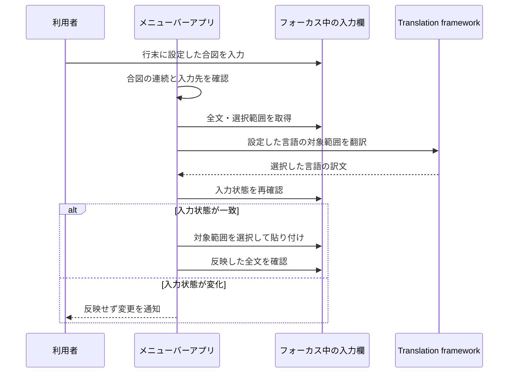

# 入力内容の翻訳の設計

## このドキュメントについて

[Requirements](requirements.md)と[Product](../../product.md)に基づき、Macの入力欄の取得・翻訳・置換を実現する。

### 対象読者

この機能を実装・変更する人とエージェント。

### 前提知識

macOSのアクセシビリティAPIは、別アプリの入力欄と選択範囲を取得できる。
利用する属性は入力欄によって異なるため、取得の成功と選択範囲の変更可否を確認する。
[AppleのAXUIElement資料](https://developer.apple.com/documentation/applicationservices/axuielement_h)を参照する。

### このドキュメントで扱わないこと

アプリごとの回避処理、配布用の公証、翻訳品質の比較は扱わない。

## 実装方針

Swift PackageでmacOS 26以降のメニューバーアプリを作る。
AppKitでメニューと準備画面を管理し、SwiftUIのtranslationTaskで言語モデルを準備する。
他の入力欄の翻訳にはTranslationSession(installedSource:target:)を使い、準備画面へフォーカスを移さずに翻訳する。
この初期化方法はインストール済みのモデルが必要なため、未準備なら準備画面を案内する。
[Appleの初期化API](https://developer.apple.com/documentation/translation/translationsession/init(installedsource:target:))と[公式サンプル](https://developer.apple.com/documentation/translation/translating-text-within-your-app)に基づく。

CarbonのRegisterEventHotKeyでCtrl＋Shift＋Aを登録する。
修飾キーが離された後に現在の行を選択する。翻訳は呼び出さず、既存の選択がある場合は維持する。
登録の失敗は準備画面で知らせる。

翻訳の合図はNSEventのローカル・グローバルのイベント監視で検出する。
両方の監視が必要なことと、グローバルのキー監視にアクセシビリティ権限が必要なことは、[Appleのイベント監視ガイド](https://developer.apple.com/library/archive/documentation/Cocoa/Conceptual/EventOverview/MonitoringEvents/MonitoringEvents.html)に基づく。
自アプリのイベント監視は起動時に開始する。他アプリのイベント監視は権限を確認してから開始する。起動時と1秒ごとの権限確認で変更を検知して開始・停止し、準備画面の手動更新に依存しない。
他アプリのキー受信時刻だけを準備画面に表示する。表示更新は最大1秒に1回とし、キーの文字列や入力履歴は保持しない。入力取得の失敗も進行表示から消さず、理由を表示する。
同じ周期でIsSecureEventInputEnabledを読み、セキュア入力で他アプリの合図を検出できない間は準備画面で知らせる。OSや他アプリの保護設定を変更しない。
監視では選んだ合図の記号の連続回数だけを持ち、キーの履歴は保持しない。
三回目の記号でフォーカス中の入力欄の識別子を保存し、入力がアプリへ反映されるまで最大600ミリ秒待つ。
待機中に別のキーやクリックがあった場合は候補を取り消す。
同じ入力欄にカーソルがあり、行末が合図になっていることを確認してから翻訳する。
貼り付けによる文字列設定はキー入力の連続と見なさない。
`...`の設定では、キーイベントの`。`も同じ合図の文字として受け付ける。

自分のアプリ内の入力欄は、ローカルイベントのwindowからNSTextViewを識別する。
自分のメインスレッドへAXの処理を送り返す方法に依存せず、NSTextViewから全文と選択範囲を取得する。
未確定の行末に合図がある場合は、NSTextInputClientのunmarkTextで入力を受け付け、Returnキーを送らずに確定する。
[AppleのunmarkText資料](https://developer.apple.com/documentation/appkit/nstextinputclient/unmarktext())に基づく。
自分の入力欄の反映は、shouldChangeText・textStorageの変更・didChangeTextを通して行い、SwiftUIへの変更通知を送る。
他アプリではAXで公開された入力情報を取得し、公開されていない未確定文字を推測で補わない。

入力の取得にはAXFocusedUIElement、AXValue、AXSelectedTextRangeを使う。
AXFocusedUIElementは最前面アプリのAXApplicationから取得し、そのアプリのプロセスIDと入力要素を組として保持する。入力要素自身のプロセスIDとの一致は要求しない。反映前も同じアプリが最前面で、そのアプリが同じ要素をフォーカスしていることを確認する。
複数プロセスのブラウザで要素の所有プロセスとアプリのプロセスを同一視せず、最前面アプリが公開するフォーカスとの一致を安全確認に使う。
パスワードのsubroleを先に確認して除外し、編集可能と確認できること、および選択範囲を変更できることを確認する。
編集可能かどうかはAXIsEditable、またはAXValueの書き込み可否で判断する。AXValueへの書き込み自体は行わない。
全文の範囲はNSStringとNSRangeのUTF-16単位で扱い、行末の改行を除く論理行を求める。
Chromiumの編集領域ではAXValueに段落の改行が追加されても、AXSelectedTextRangeの位置にはその改行が含まれない場合がある。AXStringForRangeが返す文字列とAXValueを照合し、表示上にだけ追加されたLFに限って、表示と選択APIの位置の対応を作る。他の文字の差は補正せず中止する。範囲読み取りの上限がAXValueより短い場合は、読み取り専用の二分探索で上限を求める。対応しない入力欄では従来の座標を使う。
取得時は対応する位置の候補からTextTargetの合図判定を通るものを一意に選ぶ。通常の行選択で位置が一意に決まらない場合は中止する。反映時は逆変換して選択を設定し、AXSelectedTextが置換元と一致することも確認してから貼り付ける。翻訳中のキー入力やクリックで処理をキャンセルし、表示上の別の位置が選択APIで同じ位置になる場合も利用者の操作を上書きしない。
翻訳用のTextTargetでは置換範囲に合図を含め、翻訳元の文字列からだけ合図を取り除く。
原文と訳文が同じでも、合図を除去するために置換する。

翻訳後にフォーカス・全文・選択範囲を再確認し、対象範囲を選択する。
他アプリの選択範囲の変更は即座に読み取りへ反映されるとは限らないため、最大500ミリ秒待つ。待機中は全文とフォーカスを毎回検証し、選択範囲が元の範囲と要求した範囲以外に変わったら中止する。要求した範囲を確認してから貼り付ける。
他アプリへの反映は、クリップボードへ訳文を設定して対象アプリのプロセスだけへCommand＋Vを送る。全体のHID入力経路へは送らない。キーを押してから離すまで20ミリ秒空け、キャンセル時も離すイベントは必ず同じプロセスへ送る。[Appleのプロセスを指定したイベント送信API](https://developer.apple.com/documentation/coregraphics/cgevent/posttopid(_:))を使う。
AXSelectedTextへの直接書き込みは採用しない。Arcの実機ログで、書き込み可能と判定され、設定APIも成功を返したのに本文が元のままになることを確認したため。読み取りと選択範囲の変更には引き続きAXを使う。
貼り付けを要求した後は、別方式へ切り替えたり再送したりしない。遅れて届く要求で二重に挿入されることを防ぐ。
入力欄の全文を一括設定する方式は、前後の文章やアプリの編集処理を壊すおそれがあるため採用しない。

置換を要求した後、最大2秒間、全文が期待した結果と一致するか確認する。元の文字列のままなら待機し、異なる内容への変更やフォーカス移動があれば中止する。
成功なら、クリップボードの変更回数が自分の書き込み時から変わっていない場合だけ、保存した全形式のデータを復元する。
元の形式をすべて読み取れない場合や、保存中にクリップボードが変わった場合は、書き込む前に中止する。
失敗なら一時利用したクリップボードを維持し、自動再試行しない。フォーカスが失われた場合も成功とみなさない。
貼り付け前にエラーがあった場合は、同じ入力状態であることを確認できる範囲で選択位置とクリップボードを戻す。

LanguageAvailability.supportedLanguagesから選択肢を読み、Locale.LanguageのminimalIdentifierで保持する。OS言語は言語コードと文字体系を照合し、簡体字・繁体字を混同しない。言語表示は英語ロケールで統一する。
翻訳開始時に言語の組み合わせを固定し、同一言語・未対応・未準備を区別する。設定変更で待機中の合図と実行中タスクをキャンセルする。言語状態の非同期取得も設定が一致する結果だけ反映する。
設定画面は上から言語・合図、アクセス権限、テスト欄の順にまとめる。共通の余白と標準Picker・Buttonを使い、色だけに依存せず状態を文字でも表す。キー受信・監視登録・セキュア入力の詳細はDisclosureGroup内に置く。UIとエラーは英語、READMEも英語とする。Command＋CommaでSettingsを開く。
[Appleの設定画面指針](https://developer.apple.com/design/human-interface-guidelines/settings)と[配置指針](https://developer.apple.com/design/human-interface-guidelines/layout)の、設定の絞り込み・重要度順の配置・詳細の段階的な開示に基づく。

## アーキテクチャ・シーケンス図

## データモデル・ER 図

TextTargetは全文、元の選択範囲、置換範囲、対象文字列を持つ値とする。
TranslationTriggerは三つの候補を持つ列挙型とする。保存値が未設定または不明なら`...`を使う。
CapturedInputは入力先の識別子とTextTargetを一回の処理中だけ保持する。
入力先は、自アプリのNSTextViewまたは他アプリのAXUIElementとプロセスIDで表す。
クリップボードは各NSPasteboardItemの全typeとDataを一時保持する。
永続化するデータ間の関係がないためER図は不要。

## API・インターフェース

利用者の入口は行末への合図入力、行選択のショートカット、メニューバーの「Settings…」。
準備画面から権限設定を開き、選択した言語のモデルを準備し、テスト用入力欄で試せる。
内部の翻訳処理と入力処理はプロトコルで分ける。
状態は準備完了、翻訳中、完了、理由付きの失敗とし、本文を状態文字列に含めない。
進行と結果は、入力欄の近くの非アクティブなNSPanelにも表示する。確認中と翻訳中は28ポイント四方の回転アイコンだけを表示し、完了はチェックに切り替えて1秒後に閉じる。失敗時は理由を付けた表示に広げて5秒後に閉じる。
NSPanelはキーウィンドウにならず、クリックを受けず、入力欄のフォーカスを維持する。
TextTargetは合図のUTF-16範囲を持ち、その範囲のfirstRectまたはAXBoundsForRangeで文字の位置を求める。合図の上辺から6ポイント上、横方向は合図の中央に合わせる。合図の位置を取得できなければキャレット、さらに取得できなければポインター付近を使う。幅0のキャレットも高さがあれば位置として扱う。
上側に収まらない場合は下側へ移し、複数画面も含めて表示先の画面内へ収める。進行中から完了・失敗に変わっても同じ文字の位置を基準にする。

## 外部サービスとの連携方式

外部APIへの接続・認証は追加しない。
Translation frameworkで選択した言語の組み合わせを使い、未インストールや翻訳失敗はエラーとして利用者へ返す。

## データの取り扱い設計

入力欄の本文は翻訳の合図を確認するとき、行選択時、反映確認時に取得し、処理中だけメモリに保持する。
監視では選んだ合図の記号の連続回数だけを保存し、他の文字は保存しない。
全文・訳文・クリップボードの内容をログへ出さない。
診断はOSLogの専用subsystemへ記録する。合図候補ごとに識別番号を付け、起動版、対象アプリの識別子とプロセスID、取得・翻訳・選択・反映・確認の段階、AXの戻り値、PostEventの事前確認、本文の一致/不一致だけを追う。長さと選択範囲は数値として記録するが、本文・そのハッシュ・キー入力・ウィンドウ名・URLは出さない。例外は型と数値コードだけを記録し、localizedDescriptionは記録しない。
反映確認では、元の本文のまま/期待値と一致/別の本文/取得失敗/フォーカス移動/キャンセル/時間切れを区別する。同じ状態の繰り返しは省略する。保持期間はmacOSの統合ログの管理に従い、独自の本文ログを作らない。
合図候補が本文の確認で不一致になった場合は、全文の長さ、選択範囲、論理行の範囲、選択末尾と行末の一致、行末・選択末尾・末尾空白の直前での合図の有無だけを記録する。同じ状態の繰り返しは省略する。待機期限を超えた場合は進行表示を消すだけにせず、入力欄から行末の合図とカーソル位置を確認できなかったことを表示する。
合図はUserDefaultsのtranslationTrigger、翻訳元はtranslationSource、翻訳先はtranslationTargetに保存する。翻訳元は未設定ならja、翻訳先は未設定またはsystemならLocale.preferredLanguagesを対応言語と照合し、該当なしならenを使う。本文のファイル保存は行わない。
設定を変更すると待機中の候補と連続回数を取り消し、変更後の合図だけを使う。

## 認証認可に関する特記事項

AXIsProcessTrustedWithOptionsでアクセシビリティ権限を案内する。
権限要求は準備画面の操作で行い、権限がなければ他アプリの入力の取得を開始しない。
自アプリ内では入力元のNSTextViewを直接扱い、AXの権限を要求しない。
アプリはApp Sandboxを使わず、ローカル実行用のapp bundleとして生成する。

## セキュリティ上の留意事項

AXSecureTextFieldを本文の取得前に除外する。
貼り付け前の確認と実際の入力先の編集は、OSが提供する一つの不可分な処理にはできない。
貼り付けを送った後の不一致では、利用者の変更を上書きする巻き戻しを行わない。
任意の他アプリがクリップボードを読むことは防げないため、その制約を利用方法に記載する。

## デプロイに関する特記事項

通常のローカルビルドでapp bundleを生成する。固定のコード署名証明書を使い、同じアプリ識別子と起動場所を保つ。
キーチェーンにあるApple Development証明書を使う。候補が一つなら自動で選び、それ以外はCODE_SIGN_IDENTITYで明示する。秘密鍵やキーチェーンの信頼設定は新規作成・変更しない。
署名元がなければ説明して中止し、仮署名へ自動で戻さない。一時ディレクトリで署名・検証を済ませ、証明書で署名した旧版がある場合はその署名要件も満たすことを確認してから更新する。識別子だけの条件へ緩めない。
仮署名から証明書を使う署名へ切り替える際は、一度だけ権限の登録をやり直す。以後は既定の署名要件に基づいて同じアプリとして識別できる状態を保つ。
[Appleの署名要件の説明](https://developer.apple.com/documentation/technotes/tn3127-inside-code-signing-requirements)と[アプリ更新の識別についての説明](https://developer.apple.com/library/archive/technotes/tn2206/_index.html)に基づく。Developer ID署名と公証による配布は対象外。

## 検討した代替手段

### 入力欄の全文をAXValueで書き換える

クリップボードを使わずに済むが、対象以外の編集やアプリの取り消し処理への影響が大きいため採用しない。

### コピーのキー操作で原文を取得する

AXValueが取れないアプリを増やせる可能性はあるが、選択状態やコピー内容を誤認する危険がある。
初期実装では入力状態を確認できる入力欄を扱い、取得できなければ中止する。

## 未決事項

アプリごとのアクセシビリティ対応は実機で確認する。
必要な属性を提供しないアプリへの対応方法は、対象が分かったときに要件とともに見直す。
ブラウザとターミナルは利用者から実機での対応を求められている。ターミナルでは画面・表示上の選択と入力バッファの編集が異なるため、現在のAXValue・選択・貼り付けの経路だけでは対応済みとしない。入力バッファの境界と、その内容だけを安全に置換する接点の確保が未解決。
